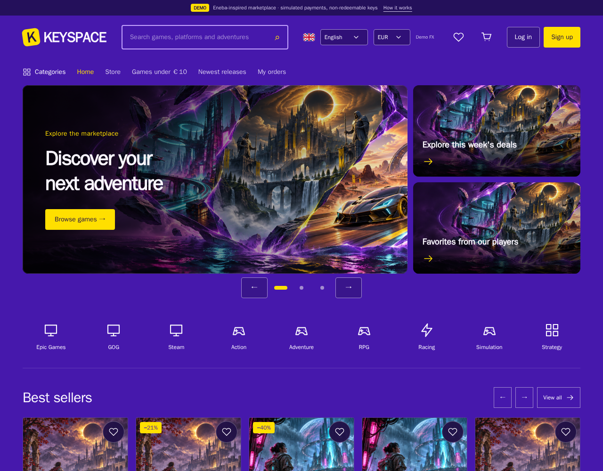
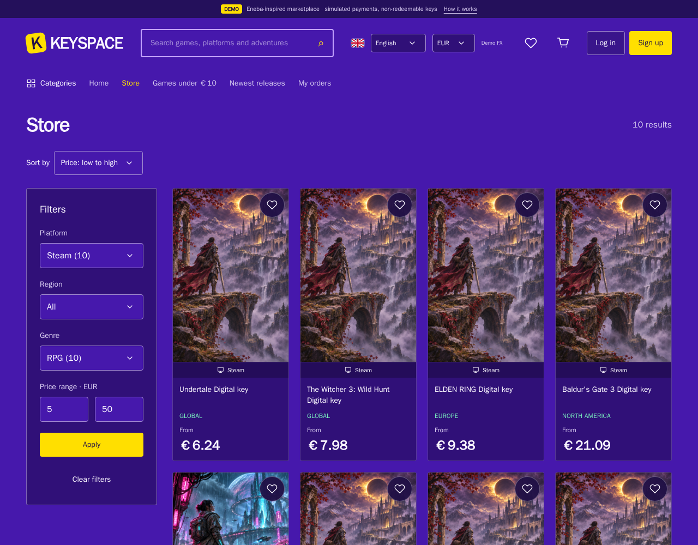
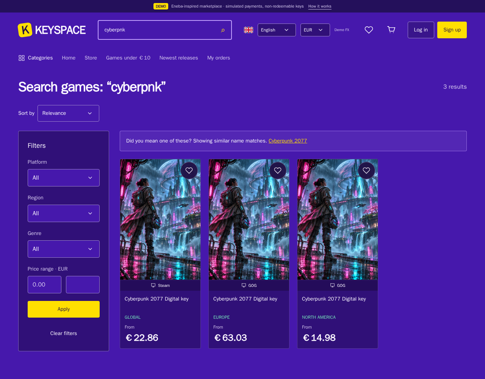
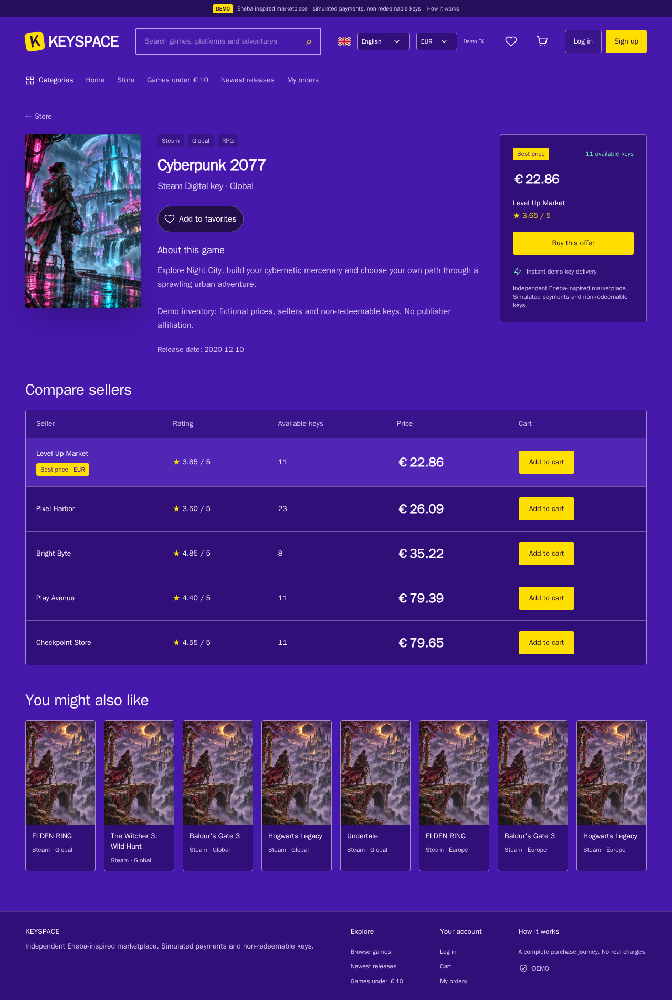
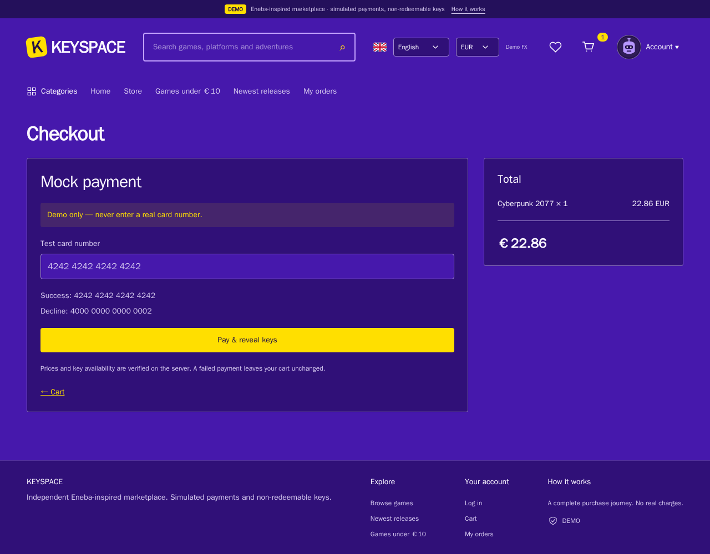
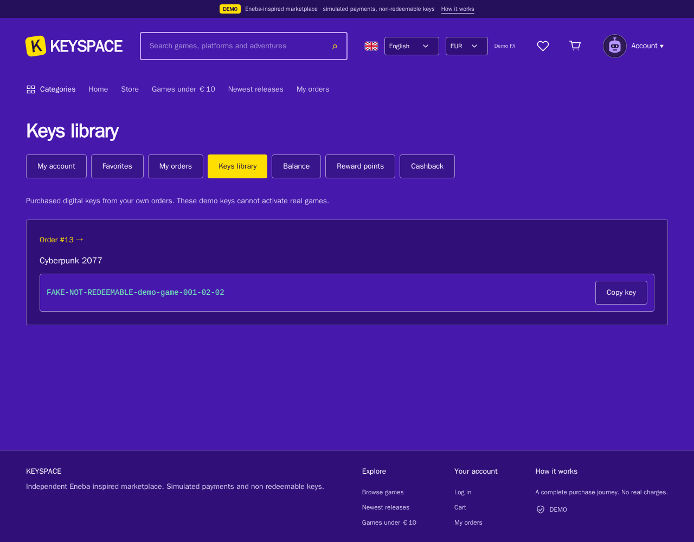

# KEYSPACE — Eneba-inspired game-key marketplace

An independent game-key marketplace inspired by Eneba, built with React, TypeScript, Go and PostgreSQL. Browse games, compare sellers, save favorites and complete a simulated purchase to receive demo digital keys.

This is a non-commercial demo and is not affiliated with Eneba or game publishers. Payments, sellers, inventory and rewards are simulated; delivered keys cannot activate games. Game titles are used as catalog references. The artwork and branding are original project assets, not official publisher covers or Eneba assets.

## Screenshots

Captured at 1280px using disposable demo data. Click an image to open the full PNG; [capture details and regeneration](docs/screenshots/README.md).

| Homepage | Store filters |
| --- | --- |
| [](docs/screenshots/homepage.png) | [](docs/screenshots/store-filters.png) |

| Typo search | Product and sellers |
| --- | --- |
| [](docs/screenshots/typo-search.png) | [](docs/screenshots/product-sellers.png) |

| Checkout | Keys library |
| --- | --- |
| [](docs/screenshots/checkout.png) | [](docs/screenshots/keys-library.png) |

## Features

- Catalog with platform, region, genre and price filters, sorting and shareable URL state.
- Typo-tolerant product search, autocomplete and recent searches.
- Product details, seller comparisons, available stock and similar products.
- Independent homepage blocks for banners, best sellers, deals and new releases.
- Registration, login, persistent sessions, editable profiles and favorites.
- Cart, transactional mock checkout, order history and a private keys library.
- English/Russian/Lithuanian interface and EUR/USD/GBP prices and orders, using fixed demo exchange rates.
- Optional email-code sign-in and one configurable OpenID Connect provider.

## Quick start

Requires Docker Engine and Compose v2; host Node/Go installations are not needed.

```sh
git clone https://github.com/smurfac4/game-key-marketplace.git
cd game-key-marketplace
cp .env.example .env
```

Keep an existing `.env` instead of overwriting it. Set a private `POSTGRES_PASSWORD` and a securely generated `JWT_SECRET` of at least 32 bytes. Optional SMTP/OIDC fields may stay empty. For port changes and detailed setup, see [Docker setup details](docs/DEVELOPMENT.md#docker-setup-details).

```sh
docker compose build api web
docker compose up -d --wait db
docker compose run --rm --no-deps api migrate up
docker compose run --rm --no-deps api seed
docker compose up -d --wait api web
```

Open http://localhost:5173 (or your configured web port). Run `seed` only for an empty catalog; skip it on subsequent starts. [Development and testing](docs/DEVELOPMENT.md) includes service addresses, smoke checks and the complete setup instructions.

## Try the purchase flow

1. Create an account with email and a password of at least 12 characters.
2. Search for a game; try `cyberpnk` to exercise typo tolerance.
3. Open a product, compare sellers and add an available offer to your cart.
4. At checkout, use one of these **mock** card numbers:

| Number | Result |
| --- | --- |
| `4242424242424242` | Successful mock payment |
| `4000000000000002` | Declined mock payment; the cart is retained |

5. Open the order confirmation or Keys library to view and copy your demo keys.

No real charge is made. Do not enter real payment details. Balance, points and cashback are illustrative account summaries, not spendable funds.

## Update an existing installation

```sh
docker compose build api web
docker compose run --rm --no-deps api migrate up
docker compose up -d --wait api web
```

Migrations are explicit; the API does not apply them at startup. Do not run the full seed again. To refresh only the recognized demo catalog's names, descriptions and artwork while preserving purchases and inventory, use `docker compose run --rm --no-deps api seed -showcase`. This command is for the seeded demo, not arbitrary catalogs.

`docker compose down` stops the project and keeps its database volume. Adding `-v` deletes that database. Backup instructions and local development commands are in [Development and testing](docs/DEVELOPMENT.md).

## Project structure

| Path | Responsibility |
| --- | --- |
| `web/` | React 19, TypeScript, Vite, Tailwind CSS, React Router and TanStack Query |
| `api/cmd/` | Go entry points for the server, migrations and seed |
| `api/internal/` | Catalog, auth, account, commerce and homepage modules |
| `api/migrations/` | Six versioned PostgreSQL migrations, embedded with golang-migrate |
| `scripts/` | Isolated test and reproduction commands |
| `ai-logs/` | AI work records, asset provenance and historical audit evidence |

The backend is a modular monolith: one Go service and one PostgreSQL database, with separate feature packages. Homepage blocks each own their repository and endpoint. Marketplace content comes from the API; interface labels are centralized in the frontend content layer.

## Checks

Requires Node.js 24+ and Go 1.26+ for host-side commands:

```sh
npm ci
npm run lint
npm run format:check
npm run build
(cd api && go test ./... && go vet ./...)
```

Database-dependent Go tests skip unless their separate test database variables are configured. The full disposable PostgreSQL runner, Playwright/Axe suite and fresh-source reproduction are documented in [Development and testing](docs/DEVELOPMENT.md). Never point test suites at your development catalog.

## Documentation

- [Configuration](docs/CONFIGURATION.md): ports, cookies, languages, currencies, SMTP and OIDC.
- [API reference](docs/API.md): routes, query parameters, request bodies and errors.
- [Development and testing](docs/DEVELOPMENT.md): local tools, disposable databases and backups.
- [Architecture and decisions](DECISIONS.md): data model, checkout, module boundaries and known limitations.
- [Assets](ai-logs/ASSETS.md): artwork and branding provenance.
- [AI assistance records](ai-logs/README.md): work log and audit reports.
- [Contribution rules](CLAUDE.md).

Early commits group pre-existing workspace files into a reconstructed development timeline; their assigned timestamps are not an original development log. That provenance is recorded in the commit messages and decision history. Later changes use normal commits.
